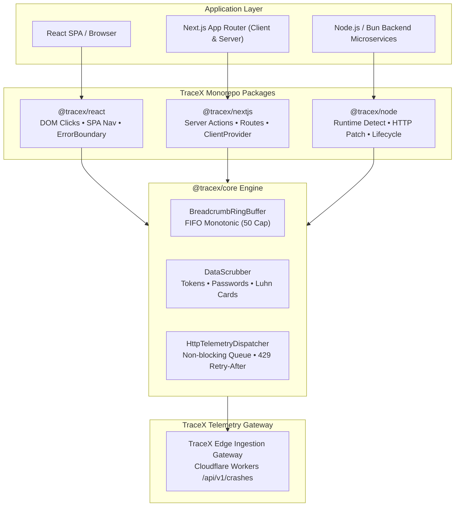

# TraceX JavaScript & TypeScript SDK

[](LICENSE)
[](https://nodejs.org)
[](https://bun.sh)
[](https://nextjs.org)
[](https://react.dev)

Production-grade crash telemetry and real-time incident intelligence SDK for JavaScript and TypeScript applications. Captures unhandled exceptions, unhandled promise rejections, React component crashes, Next.js Server Actions, and API Route Handler failures with automatic circular breadcrumb tracking, rigorous PII sanitization, and resilient rate-limited network transport.

---

## Architecture Overview



---

## Monorepo Package Matrix

| Package | Runtime Target | Version | Description |
|---|---|---|---|
| [`@tracex/core`](./packages/core) | Isomorphic (Browser, Node, Bun, Edge) | `0.1.0` | Core telemetry engine: FIFO ring buffer, PII scrubber, 429 backoff dispatcher. |
| [`@tracex/node`](./packages/node) | Node.js `>=18.0.0`, Bun | `0.1.0` | Server SDK: Uncaught errors, HTTP client breadcrumbs, process lifecycle. |
| [`@tracex/react`](./packages/react) | Browser, React `>=16.8.0`, React 18, React 19 | `0.1.0` | Client SDK: `<TraceXErrorBoundary>`, DOM click tracking, SPA navigation. |
| [`@tracex/nextjs`](./packages/nextjs) | Next.js App Router & Pages Router | `0.1.0` | Full-stack SDK: `withTraceXServerAction`, `withTraceXRoute`, `<TraceXClientProvider>`. |
| [`@tracex/example-node-bun`](./examples/node-bun-sample) | Node.js & Bun CLI | `0.1.0` | Dual-runtime showcase application with automated walkthrough & interactive menu. |
| [`@tracex/example-nextjs`](./examples/nextjs-app-router-sample) | Next.js 16 App Router | `0.1.0` | Dark-themed developer dashboard testbed for client, action, and route crashes. |

---

## Quickstart Guide

### 1. Installation

Install the package suited for your application:

```bash
# For Next.js full-stack applications:
bun add @tracex/nextjs
# or: npm install @tracex/nextjs

# For React browser single-page applications:
bun add @tracex/react
# or: npm install @tracex/react

# For Node.js or Bun backend servers:
bun add @tracex/node
# or: npm install @tracex/node
```

---

### 2. Next.js App Router Integration

#### Root Layout (`app/layout.tsx`)

Wrap your application in `<TraceXClientProvider>` to establish client error boundaries and telemetry listeners:

```tsx
import { TraceXClientProvider } from '@tracex/nextjs/client';

export default function RootLayout({ children }: { children: React.ReactNode }) {
  return (
    <html lang="en">
      <body>
        <TraceXClientProvider
          options={{
            projectKey: process.env.NEXT_PUBLIC_TRACEX_PROJECT_KEY || 'tracex_live_demo_00000000',
            endpoint: process.env.NEXT_PUBLIC_TRACEX_ENDPOINT,
          }}
        >
          {children}
        </TraceXClientProvider>
      </body>
    </html>
  );
}
```

#### Server Actions (`app/actions.ts`)

Wrap Server Actions with `withTraceXServerAction` to automatically record duration, scrub sensitive `FormData` fields, and capture exceptions:

```typescript
'use server';

import { withTraceXServerAction } from '@tracex/nextjs/server';

export const checkoutAction = withTraceXServerAction('checkoutAction', async (formData: FormData) => {
  // Passwords, bearer tokens, and credentials in formData are scrubbed automatically in telemetry
  const orderId = formData.get('orderId');
  if (!orderId) {
    throw new Error('Order processing failed: Invalid payload');
  }
  return { success: true };
});
```

#### Route Handlers (`app/api/crash/route.ts`)

Wrap route handlers with `withTraceXRoute` to format unhandled exceptions into RFC 7807 JSON responses:

```typescript
import { withTraceXRoute } from '@tracex/nextjs/server';

export const GET = withTraceXRoute(async (request: Request) => {
  throw new Error('Database connection pool exhausted');
});
```

---

### 3. React Browser SPA Integration

Initialize TraceX and wrap component subtrees with `<TraceXErrorBoundary>`:

```tsx
import React from 'react';
import ReactDOM from 'react-dom/client';
import { TraceX, TraceXProvider, TraceXErrorBoundary } from '@tracex/react';

// 1. Initialize client singleton
TraceX.init({
  projectKey: 'tracex_live_my_react_app_001',
  instrumentClicks: true,
  instrumentNavigation: true,
});

ReactDOM.createRoot(document.getElementById('root')!).render(
  <React.StrictMode>
    <TraceXProvider>
      <TraceXErrorBoundary
        fallback={({ error, reset, eventId }) => (
          <div role="alert">
            <h2>Something went wrong</h2>
            <p>{error.message}</p>
            <p>Reference: {eventId}</p>
            <button onClick={reset}>Try again</button>
          </div>
        )}
      >
        <App />
      </TraceXErrorBoundary>
    </TraceXProvider>
  </React.StrictMode>
);
```

---

### 4. Node.js & Bun Backend Integration

```typescript
import { TraceX } from '@tracex/node';

// Initialize singleton with automatic runtime detection
TraceX.init({
  projectKey: process.env.TRACEX_PROJECT_KEY || 'tracex_live_node_app_001',
  captureUncaughtExceptions: true,
  captureUnhandledRejections: true,
  instrumentHttp: true,
  instrumentLifecycle: true,
});

// Record user or domain breadcrumbs
TraceX.addBreadcrumb({
  category: 'auth',
  action: 'login',
  target: 'user_session',
  data: { userId: 'usr_10293' },
});

// Handled exception capture
try {
  // Database or third-party query...
} catch (error) {
  const eventId = TraceX.captureException(error, { query: 'SELECT * FROM users' });
  console.log(`Incident captured with reference ID: ${eventId}`);
}

// Await queue drain before process exit
await TraceX.flush(3000);
```

---

## Core Capabilities & Pipeline Guarantees

### 1. Breadcrumb Ring Buffer (FIFO Monotonic)
Maintains a 50-item circular ring buffer with strictly increasing monotonic sequence order numbers. When capacity is reached, the oldest entries are cleanly evicted FIFO, ensuring incident reports contain fresh context without unbound memory growth.

### 2. Deep PII & Secret Redaction
All strings, breadcrumb payloads, error messages, and context metadata are sanitized by `DataScrubber`:
- **Bearer Tokens**: `Bearer [REDACTED]`
- **Credentials & Passwords**: `password`, `secret`, `apiKey`, `token` values scrubbed to `[REDACTED]`
- **Credit Card Numbers**: Luhn-checksum validated 13–19 digit cards masked to `[CARD_REDACTED]`
- **Local File Paths**: User system directories (`/Users/...`, `C:\Users\...`) masked to `[PATH_REDACTED]`

### 3. Resilient Network Transport & 429 Backoff
The `HttpTelemetryDispatcher` runs an asynchronous, non-blocking queue. Upon receiving HTTP 429 (Too Many Requests), the dispatcher parses the `Retry-After` header, pauses queue dispatch, and schedules retries with exponential backoff and jitter without dropping telemetry.

---

## Sample Applications

The monorepo provides two runnable reference applications demonstrating real-world usage:

### 1. Dual-Runtime Node.js & Bun CLI Sample (`examples/node-bun-sample`)

Run automated walkthrough under Bun:
```bash
bun run example:bun
```

Run automated walkthrough under Node.js:
```bash
bun run example:node
```

Launch interactive crash menu:
```bash
bun run --filter @tracex/example-node-bun start:interactive
```

### 2. Next.js 16 App Router Sample (`examples/nextjs-app-router-sample`)

Launch the Next.js development server:
```bash
bun run example:next
```

Build and test production Next.js output:
```bash
bun run --filter @tracex/example-nextjs build
```

---

## Development & Testing Commands

```bash
# Execute entire test suite (176 unit and cross-package E2E tests)
bun test

# Execute E2E integration test pipeline only
bun run test:e2e

# Run strict TypeScript compilation check across all packages and examples
bun run typecheck

# Build all packages and sample applications across the monorepo
bun run build
```

---

## License

MIT © 2026 TraceX Platform Team.